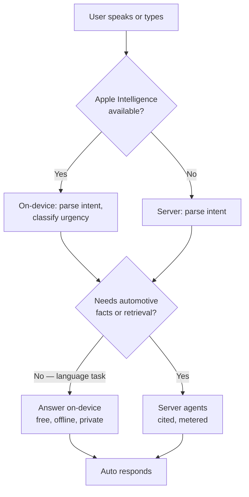

# 14. Auto — The Pocket Mechanic

[← Parts Finder](13-parts-finder.md) · [Index](README.md) · Next: [Pocket Garage →](15-pocket-garage.md)

**Auto** is the character the user talks to. Not a chat bubble with a cursor — a small
shop robot who lives in your glovebox, knows your car, and has opinions about it.

He replaces the faceless "Sky" persona. Same job, same refusal boundaries, a face.

## Who Auto is

A hand-sized robot built out of garage parts: hex-nut head, chrome body, a single work-
lamp eye, magnetic feet so he can stand on a fender. He carries a wrench slightly too
big for him. Original design — see [`/design/auto`](../design/auto/) for the sheet.

**Personality.** Twenty-five years in the trade, genuinely likes teaching, has no
financial interest in you needing work done. Warm, blunt, unhurried. Says "I don't know"
easily. Never condescending — not knowing how a car works is the normal condition.

**What he never does:** talk down, upsell, guess at a torque spec, or tell you a car is
safe to drive when it isn't. The hard-stop list in [section 11](11-safety-and-ethics.md)
is his, unchanged.

### Auto's states

He is a state machine with a face, not an animation reel:

| State | What it means | Look |
| --- | --- | --- |
| **Idle** | Waiting | Lamp eye dim, slow blink |
| **Listening** | Mic open | Eye bright, lamp ring pulses with input level |
| **Thinking** | Working | Eye narrows, wrench taps |
| **Found it** | Answer ready | Eye bright, slight lean forward |
| **Careful** | A warning applies | Eye amber, hands up |
| **Stop** | Hard-stop or danger | Eye red, wrench down, blocks the screen |
| **Can't help** | Outside his limits | Eye dim, shrug |

"Stop" and "Careful" are not decorative. They are the visual half of the severity system
in [section 7](07-obd-ii.md), and they always appear with the word and the icon.

## Auto's brain: a deliberate split

Auto runs on **two** models, and which one answers depends on the question. This is the
most important engineering decision in this section.

### On-device — Apple Intelligence (Foundation Models framework)

Apple's on-device model is free, private, works offline, and has no per-call cost. It is
also small: roughly a **4,096-token context for input and output combined**, a training
cutoff around October 2023, text only, and documented weakness at complex reasoning and
factual recall.

So it is wrong for diagnosis and right for language work. Auto uses it for:

- **Understanding what you said.** Turning "it's making a clunking noise when I turn
  left" into a structured intent, via the `@Generable` macro — typed Swift output, no
  JSON parsing.
- **Classifying urgency** from the user's own words, to decide whether to route to
  Roadside before anything else.
- **Summarizing** a service history, or a long guide, into a few lines.
- **Drafting what to say to the mechanic** — "here's how to describe this at the
  counter."
- **Tagging and extracting** from receipts the user typed in.

What it must **never** do: produce a torque spec, a fluid capacity, a part number, a
service interval, or a diagnosis. Those come from the fitment database or a cited
source, per [section 11](11-safety-and-ethics.md). The on-device model has no automotive
knowledge worth trusting and would hallucinate them confidently.

### Server-side — the reasoning model

Everything that needs real automotive knowledge, retrieval over the guide corpus, code
correlation, or web lookup goes to the server agents in
[section 8](08-ai-agents.md). Unchanged.

### The routing rule

### Availability is not optional

Apple Intelligence requires **iOS 26 or later on an Apple Intelligence-capable device**,
and the user must have it enabled. That excludes a large share of the installed base —
including, pointedly, the older phones that budget-conscious drivers are most likely to
carry.

So:

- Check `SystemLanguageModel.default.availability` before every session.
- Handle every unavailable reason: device ineligible, not enabled, model not ready, and
  unknown — the framework is young and new reasons appear.
- **The server path is the fallback, and the app never degrades in capability** — only
  in cost and privacy. A user on an iPhone 12 gets the same answers.
- Never show the user an error about Apple Intelligence. Route and move on.

### Two more constraints worth designing around

- **Apple's safety guardrails produce false positives**, and automotive language is full
  of trigger words — "bleed the brakes", "kill the engine", "blow the head gasket". Every
  prompt needs testing against the guardrails, and a guardrail rejection must fall
  through to the server, not surface as a failure.
- **Apple can update the model without a version pin.** Behavior will shift under you.
  Keep on-device work to tasks where a small drift is harmless, and never put a safety
  decision solely on-device.

## Auto and the Maps handoff

Auto doesn't try to be a map. He hands off to the app the user already trusts.

**How it works:** `MKLocalSearch` finds nearby shops, parts stores, or hardware stores
around the user's current location. Auto shows them ranked with distance and, where the
data exists, price. Choosing one calls `MKMapItem.openInMaps` — Apple Maps opens with
turn-by-turn, live traffic, and CarPlay already handled.

**Why handoff instead of in-app navigation:** in-app turn-by-turn means licensing a
navigation SDK (see [section 13](13-parts-finder.md)). Apple Maps is free, already
installed, already trusted for driving, and better than anything SkyLink would ship in
v1. The user ends up where they need to be, which is the actual goal.

**What Auto says before handing off:** the shop name, the distance, why it's the pick,
and what it should cost. Then: "Want me to open Maps?" — and a tap does it. Never a
silent redirect out of the app.

**Location permission is "While Using the App."** Same reasoning as
[section 13](13-parts-finder.md). Finding a shop is deliberate; the app is open.

| Search | What Auto looks for |
| --- | --- |
| Repair shop | `MKPointOfInterestCategory.carRepair` |
| Parts store | Auto parts retailers by name + category |
| Hardware store | Tools, bolts, consumables — often cheaper |
| Gas | `.gasStation` |
| Car wash, towing | `.carWash`, roadside partners |

## What Auto is not

Not a pet to feed, not a streak to maintain, not a thing that guilts you. No hunger
meter, no decay, no "Auto misses you" notification. He is a mechanic with a face, and
the moment he needs tending he becomes another chore in a product whose entire promise
is removing one.
